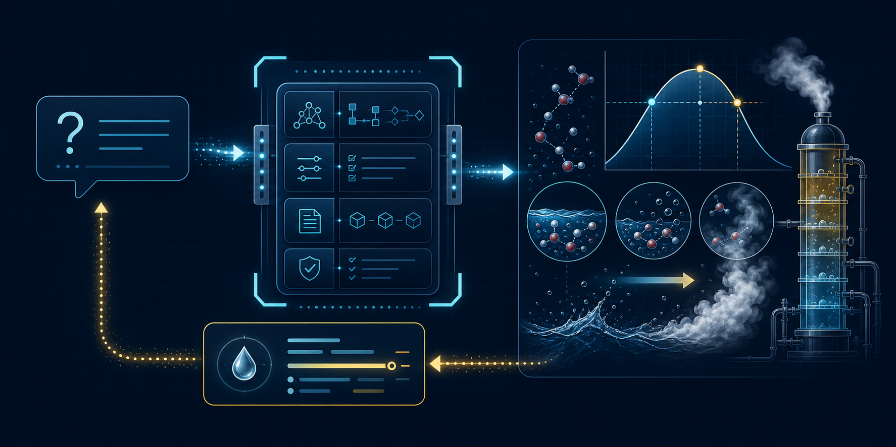

# vle-mcp



*Hero image generated with ChatGPT Images via OpenAI Codex (GPT-5.6 Sol).*

An educational Model Context Protocol server for the
[`vle`](https://github.com/miguelju/vle) and
[`stages-thermo`](https://github.com/miguelju/stages-thermo) scientific
libraries.

The first tool calculates the boiling temperature of water at an absolute
pressure using `vle-steam`'s IAPWS-IF97 implementation. The chatbot interprets
and explains the request; tested scientific software supplies the number.

## Status

M0 through M3 are implemented and locally verified. The project supports local
stdio and an OAuth-protected Streamable HTTP ASGI application factory for
remote deployment. Verification includes protocol round trips over both
transports, a real stdio subprocess handshake, RFC 9728 metadata, bearer scope
and resource binding, and remote resource limits. See [PLAN.md](PLAN.md),
[TODO.md](TODO.md), [the M2 verification record](docs/m2-client-verification.md),
and [the M3 remote guide](docs/remote-http.md).

## Why MCP?

MCP gives AI clients a standard way to discover and call typed tools. It
separates natural-language reasoning from authoritative programs and data:

- the model determines intent;
- the MCP client controls connections and tool use;
- this server validates a typed request;
- `vle-steam` performs the scientific calculation.

See [docs/mcp-primer.md](docs/mcp-primer.md) for the protocol path and
[docs/architecture.md](docs/architecture.md) for the component architecture.
[PLAN.md](PLAN.md) records the Python and API-granularity decisions.

## Development setup

Python 3.11 or newer is required.

```sh
python3 -m venv .venv
.venv/bin/python -m pip install --upgrade pip
.venv/bin/python -m pip install -e '.[dev]'
.venv/bin/vle-mcp
```

The last command starts a stdio MCP server and waits for a client. It is not an
interactive shell; use an MCP client or the protocol tests.

For development against a local `vle` checkout, install its Python package into
the virtual environment according to that repository's build instructions.
Do not commit a machine-specific path.

For remote clients, integrate the ASGI factory with a maintained OAuth token
verifier and HTTPS ingress. The remote endpoint deliberately cannot start
without those operator-owned security inputs. See
[docs/remote-http.md](docs/remote-http.md).

## Tool

### `water_saturation_temperature`

Inputs:

- `pressure`: positive finite number;
- `pressure_unit`: `Pa`, `kPa`, `MPa`, `bar`, or `atm`;
- all pressure is absolute.

Example arguments:

```json
{"pressure": 101.325, "pressure_unit": "kPa"}
```

The result is approximately `373.1243 K` or `99.9743 °C`. It includes the
normalized pressure and IAPWS-IF97 provenance.

## Verification

```sh
.venv/bin/python scripts/check_public_data.py
.venv/bin/ruff check .
.venv/bin/ruff format --check .
.venv/bin/pytest
.venv/bin/python scripts/verify_stdio_client.py --command .venv/bin/vle-mcp
```

## Security

The tools remain read-only and deterministic. Stdio requires no credentials;
Streamable HTTP requires a resource-bound bearer token with `vle:read`. Read
[SECURITY.md](SECURITY.md), [docs/security-model.md](docs/security-model.md),
and [docs/remote-http.md](docs/remote-http.md) before deployment or extension.

## Authorship

Miguel Jackson owns and directs the project. M0 through M3 were implemented
collaboratively by OpenAI Codex using the GPT-5.6 Sol model, following Miguel's
instructions and approved plan. See [AUTHORS.md](AUTHORS.md) for the precise
human/AI attribution and limitations.

## License

MIT
