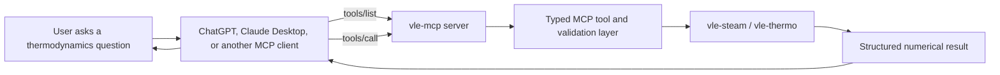

# Architecture

## Purpose

`vle-mcp` is a protocol adapter between MCP-capable AI clients and tested
thermodynamic software. The language model interprets a question and explains
the answer, but it does not own the scientific calculation. The numerical
result comes from a narrow domain API and returns through MCP as typed,
structured data.

The architecture deliberately separates:

1. conversational intent;
2. MCP discovery and invocation;
3. schema validation and unit normalization;
4. scientific computation;
5. structured result presentation.

This separation makes numerical provenance testable and prevents the protocol
layer from becoming a second thermodynamics implementation.

## System flow



M1 implemented the `vle-steam / vle-thermo` path with one tool. The server now
publishes 14 tools over the same path; see [Tool catalogue](#tool-catalogue).

## Component responsibilities

| Component | Owns | Must not own |
|---|---|---|
| User | Engineering question and supplied conditions | Protocol details |
| MCP client | Conversation, model execution, server connection, tool selection and approval | Thermodynamic equations |
| `vle-mcp` server | MCP lifecycle, capability publication, tool dispatch | Duplicated scientific algorithms |
| Validation layer | Types, supported units, finite/range checks, canonicalization, public errors | Hidden corrections to domain results |
| `vle-steam` / `vle-thermo` | Thermodynamic models and numerical correctness | Client-specific conversation behavior |
| Structured result | Values, units, basis, method, and library provenance | Natural-language speculation |

## Discovery: `tools/list`

After initialization, an MCP client calls `tools/list`. The server publishes the
available tool names, descriptions, generated JSON schemas, and read-only
annotations. The server publishes:

```text
water_saturation_temperature        list_components
water_saturation_properties         component_properties
water_state                         mixture_flash
petroleum_fraction_properties       mixture_bubble_point
petroleum_boiling_point_at_pressure mixture_dew_point
petroleum_normal_boiling_point      mixture_critical_point
                                    mixture_phase_envelope
                                    mixture_phase_properties
```

For `water_saturation_temperature`, the schema tells the client that:

- `pressure` is numeric;
- `pressure_unit` is an enumeration;
- pressure is absolute;
- the result has a stable structured shape.

Tool descriptions are operational contracts. They should be specific enough
for a model to choose the correct tool without embedding application policy or
untrusted instructions.

## Invocation: `tools/call`

For the question “What is the boiling temperature of water at atmospheric
pressure?”, the request path is:

1. The client recognizes that an authoritative saturation calculation is
   available.
2. It calls `water_saturation_temperature` with `1 atm` or `101.325 kPa`.
3. `vle-mcp` rejects non-finite, non-positive, unsupported, or out-of-range
   input.
4. The validation layer converts the pressure once to kPa absolute.
5. The adapter calls `vle.steam.tsat(pressure_kpa)`.
6. `vle-steam` evaluates the IAPWS-IF97 Region 4 inverse saturation relation.
7. The server returns Kelvin, Celsius, normalized pressure, reference basis,
   library name, and calculation method.
8. The client supplies this result to the model for explanation.

At standard atmospheric pressure, the tested result is approximately
`373.1243 K` or `99.9743 °C`.

## Why the typed validation layer exists

MCP tool arguments originate in model-selected output and must be treated as
untrusted input. The validation layer narrows that input before it crosses into
the domain library:

```text
model arguments
  -> type validation
  -> unit enumeration
  -> finite and positive checks
  -> IF97 range check
  -> canonical kPa absolute
  -> domain call
```

Canonicalization occurs at one boundary. The domain function does not need to
guess whether a value is gauge pressure, absolute pressure, bar, MPa, or kPa.

The layer also converts dependency failures into stable public errors. Internal
stack traces, paths, and dependency details are not returned to the client.

## Domain API granularity

The quality of an MCP tool depends on the quality of the program beneath it.
`vle.steam.tsat(pressure)` is a suitable domain boundary because it represents
one cohesive engineering operation with explicit units, bounded cost, and
deterministic errors.

Two boundaries would be worse:

- A monolithic `run_simulation(payload)` call is too broad to validate,
  authorize, explain, or recover safely.
- Exposing individual IF97 coefficients or numerical iterations is too fine;
  it would make the model orchestrate an algorithm owned by the scientific
  library.

The preferred tool boundary is a complete domain operation. When a future tool
cannot be expressed this way, improve the upstream API before adding logic to
the MCP adapter.

## Result contract

`water_saturation_temperature` returns a Pydantic model equivalent to:

```json
{
  "substance": "water",
  "temperature": {
    "kelvin": 373.1243,
    "celsius": 99.9743
  },
  "pressure": {
    "value": 101.325,
    "unit": "kPa",
    "basis": "absolute"
  },
  "calculation": {
    "library": "vle-steam",
    "method": "IAPWS-IF97 Region 4 saturation equation"
  }
}
```

Numbers without units and provenance are not sufficient engineering results.
The structure lets clients render or post-process values without parsing prose.

## Transport boundary

M1 uses stdio. The client launches `vle-mcp` as a child process and exchanges
MCP messages over stdin/stdout:

```text
local client -> stdin/stdout -> vle-mcp process
```

stdout is reserved for protocol messages; diagnostics belong on stderr. This
keeps local setup small and avoids opening a network listener.

The future remote architecture will use Streamable HTTP, HTTPS, authorization,
audience-bound tokens, and request limits. Changing the transport alone is not
a secure deployment.

## Security boundaries

The server assumes user text, model-selected arguments, client metadata, and
dependency exception text may be hostile or malformed. M1 limits impact by
being read-only, deterministic, file-system independent, and credential-free.

The iterative mixture tools are additionally bounded:

- **Component count:** 1 to 10 names, resolved only against the bundled
  database; critical point and phase envelope require at least 2.
- **Composition:** each fraction finite and greater than zero, summing to one
  within 0.001. vle accepts a composition summing to 1.2 without complaint, so
  this check cannot be left to the library.
- **Operating specification:** temperature 1 to 2000 K and pressure 0.001 to
  100000 kPa absolute. vle accepts a negative absolute temperature without
  complaint.
- **Models:** an enumerated list of cubic equations of state; no
  user-supplied critical constants, interaction matrices, or activity models.
- **Solver effort:** iterations capped at 200; the phase envelope is capped at
  120 points.
- **Failure:** non-convergence, NaN results, and Rust engine panics become a
  fixed public message. A panic reaches Python as pyo3's `PanicException`,
  which derives from `BaseException`, not `Exception`. Catching only
  `Exception` would let it escape the SDK's tool-error handling.

Tools are synchronous and run on the server's event loop, so the remote
request timeout cannot interrupt one mid-solve. The iteration caps are the
effective bound: in local probes the slowest call (a non-converging bubble
point at 99,000 kPa) took about 150 ms. A 10-component, 120-point envelope took
about 4 ms.

See [security-model.md](security-model.md) for the threat model and remote
authorization requirements.

## Tool catalogue

The catalogue was reviewed against the `vle-thermo` 0.18.0 public API. One
module per domain area lives under `src/vle_mcp/tools/`:

| Module | `vle` API used | Tools |
|---|---|---|
| `water.py` | `vle.steam` (`tsat`, `saturation`, `Water`) | 3 |
| `components.py` | `vle.components` (`available`, `all_components`, `get`) | 2 |
| `mixture.py` | `vle.System` (flash, bubble/dew, critical point, envelope, phase properties) | 6 |
| `petroleum.py` | `vle.petroleum` (`estimate`, Maxwell-Bonnell, API/SG conversion) | 3 |

Deliberately **not** exposed:

| `vle` API | Reason |
|---|---|
| `*_batch` methods, `steam.properties`/`ph_flash`/`sat_table`/`transport` | Array inputs with unbounded size; a model asks one question at a time |
| `units.set_atmospheric_pressure` | Mutates process-global state shared by every client |
| `System.from_arrays`, custom `Component`, `kij`/`aij`/`alpha`, activity models | Arbitrary user parameters widen the input surface; a candidate once bounded schemas exist |
| `System.flash_ph` | Needs a feed enthalpy on the EOS reference state and a temperature bracket, which are hard for a model to supply correctly |
| `System.flash_free_water` | Specialized water-decant flash; a candidate for a later review |
| `petroleum.Assay`, `cut_curve`, `convert_curve` | Whole distillation curves as arrays; a candidate for a bounded assay tool |
| `System.stability`, `k_values*`, `d_ln_phi_*`, `partial_molar_enthalpy`, Lee-Kesler methods, `refinery.*` | Solver internals and reduced-state building blocks; `mixture_flash` already answers whether a feed splits |
| `steam.psat`, `latent_heat`, `viscosity`, `surface_tension`, … | Covered by `water_saturation_properties` and `water_state` |
| `plots`, `cli`, `db` | Rendering, command-line, and file side effects |

Upstream behavior found during the review (vle-thermo 0.18.0):

- `System.critical_point` raises "unsupported" for Schmidt-Wenzel and
  Patel-Teja, and **panics** for van der Waals (`critical.rs`, `unwrap` on
  `None`). `mixture_critical_point` therefore accepts only PR, SRK, RK, and
  PRSV.
- No Peneloux volume shift is defined for VdW, Schmidt-Wenzel, or Patel-Teja,
  so `mixture_phase_properties` reports `mass_density` as null for those.

## Extension path

New `vle` capabilities join at the typed domain-adapter boundary, in the
matching module under `src/vle_mcp/tools/`, and are registered through that
module's `TOOLS` tuple. Each new tool gets an API-granularity review first and
is not callable until it is registered and tested and its `TODO.md` item is
checked off.

The transport, validation, and result conventions remain shared; the scientific
engine behind a tool can change without changing how clients discover and call
the server.
