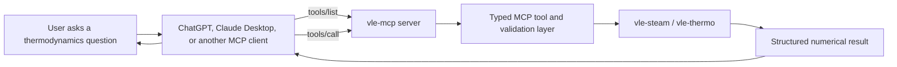

# Architecture

## Purpose

`vle-mcp` is a protocol adapter between MCP-capable AI clients and tested
thermodynamic software. The language model interprets a question and explains
the answer, but it does not own the scientific calculation. The numerical
result comes from a narrow domain API and returns through MCP as typed,
structured data.

The architecture deliberately separates:

1. conversational intent;
2. MCP discovery and invocation;
3. schema validation and unit normalization;
4. scientific computation;
5. structured result presentation.

This separation makes numerical provenance testable and prevents the protocol
layer from becoming a second thermodynamics implementation.

## System flow



The `vle-steam / vle-thermo` path is implemented in M1. Today it exposes one
tool, `water_saturation_temperature`; further `vle` tools are planned work, not
shipped capabilities.

## Component responsibilities

| Component | Owns | Must not own |
|---|---|---|
| User | Engineering question and supplied conditions | Protocol details |
| MCP client | Conversation, model execution, server connection, tool selection and approval | Thermodynamic equations |
| `vle-mcp` server | MCP lifecycle, capability publication, tool dispatch | Duplicated scientific algorithms |
| Validation layer | Types, supported units, finite/range checks, canonicalization, public errors | Hidden corrections to domain results |
| `vle-steam` / `vle-thermo` | Thermodynamic models and numerical correctness | Client-specific conversation behavior |
| Structured result | Values, units, basis, method, and library provenance | Natural-language speculation |

## Discovery: `tools/list`

After initialization, an MCP client calls `tools/list`. The server publishes the
available tool names, descriptions, and generated JSON schemas. M1 publishes:

```text
water_saturation_temperature
```

Its schema tells the client that:

- `pressure` is numeric;
- `pressure_unit` is an enumeration;
- pressure is absolute;
- the result has a stable structured shape.

Tool descriptions are operational contracts. They should be specific enough
for a model to choose the correct tool without embedding application policy or
untrusted instructions.

## Invocation: `tools/call`

For the question “What is the boiling temperature of water at atmospheric
pressure?”, the request path is:

1. The client recognizes that an authoritative saturation calculation is
   available.
2. It calls `water_saturation_temperature` with `1 atm` or `101.325 kPa`.
3. `vle-mcp` rejects non-finite, non-positive, unsupported, or out-of-range
   input.
4. The validation layer converts the pressure once to kPa absolute.
5. The adapter calls `vle.steam.tsat(pressure_kpa)`.
6. `vle-steam` evaluates the IAPWS-IF97 Region 4 inverse saturation relation.
7. The server returns Kelvin, Celsius, normalized pressure, reference basis,
   library name, and calculation method.
8. The client supplies this result to the model for explanation.

At standard atmospheric pressure, the tested result is approximately
`373.1243 K` or `99.9743 °C`.

## Why the typed validation layer exists

MCP tool arguments originate in model-selected output and must be treated as
untrusted input. The validation layer narrows that input before it crosses into
the domain library:

```text
model arguments
  -> type validation
  -> unit enumeration
  -> finite and positive checks
  -> IF97 range check
  -> canonical kPa absolute
  -> domain call
```

Canonicalization occurs at one boundary. The domain function does not need to
guess whether a value is gauge pressure, absolute pressure, bar, MPa, or kPa.

The layer also converts dependency failures into stable public errors. Internal
stack traces, paths, and dependency details are not returned to the client.

## Domain API granularity

The quality of an MCP tool depends on the quality of the program beneath it.
`vle.steam.tsat(pressure)` is a suitable domain boundary because it represents
one cohesive engineering operation with explicit units, bounded cost, and
deterministic errors.

Two boundaries would be worse:

- A monolithic `run_simulation(payload)` call is too broad to validate,
  authorize, explain, or recover safely.
- Exposing individual IF97 coefficients or numerical iterations is too fine;
  it would make the model orchestrate an algorithm owned by the scientific
  library.

The preferred tool boundary is a complete domain operation. When a future tool
cannot be expressed this way, improve the upstream API before adding logic to
the MCP adapter.

## Result contract

The current tool returns a Pydantic model equivalent to:

```json
{
  "substance": "water",
  "temperature": {
    "kelvin": 373.1243,
    "celsius": 99.9743
  },
  "pressure": {
    "value": 101.325,
    "unit": "kPa",
    "basis": "absolute"
  },
  "calculation": {
    "library": "vle-steam",
    "method": "IAPWS-IF97 Region 4 saturation equation"
  }
}
```

Numbers without units and provenance are not sufficient engineering results.
The structure lets clients render or post-process values without parsing prose.

## Transport boundary

M1 uses stdio. The client launches `vle-mcp` as a child process and exchanges
MCP messages over stdin/stdout:

```text
local client -> stdin/stdout -> vle-mcp process
```

stdout is reserved for protocol messages; diagnostics belong on stderr. This
keeps local setup small and avoids opening a network listener.

The future remote architecture will use Streamable HTTP, HTTPS, authorization,
audience-bound tokens, and request limits. Changing the transport alone is not
a secure deployment.

## Security boundaries

The server assumes user text, model-selected arguments, client metadata, and
dependency exception text may be hostile or malformed. M1 limits impact by
being read-only, deterministic, file-system independent, and credential-free.

Future iterative `vle` tools (for example, multicomponent calculations) must
additionally bound:

- component counts;
- solver time and concurrency;
- convergence and cancellation behavior;
- permitted models and operating specifications;
- result size.

See [security-model.md](security-model.md) for the threat model and remote
authorization requirements.

## Extension path

New `vle` capabilities join at the typed domain-adapter boundary, one module
per domain area under `src/vle_mcp/tools/`. Each future tool will undergo an
API-granularity review before registration; none is callable until it is
registered, tested, and checked off in `TODO.md`.

The transport, validation, and result conventions remain shared; the scientific
engine behind a tool can change without changing how clients discover and call
the server.
